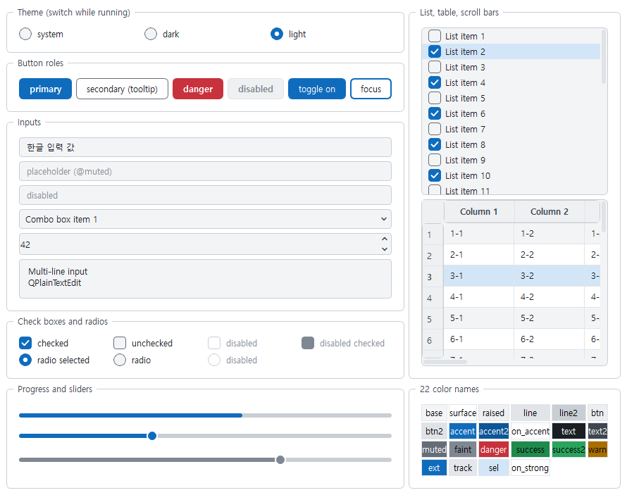
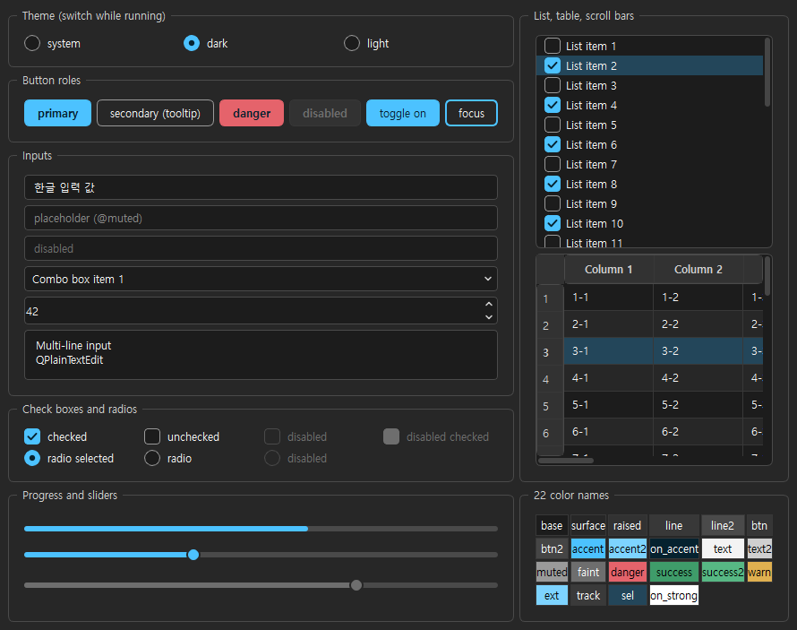

<p align="center">
  <strong>Language:</strong>
  <a href="README.md">English</a> |
  <a href="README.ko.md">한국어</a> |
  <a href="README.zh-CN.md">简体中文</a> |
  <a href="README.ja.md">日本語</a> |
  <a href="README.es.md">Español</a> |
  <a href="README.ru.md">Русский</a>
</p>

Este documento es una traducción automática con IA de la versión en inglés. Si hay diferencias, prevalece la versión en inglés.

# Designarche

<p align="center">
  <a href="LICENSE"></a>
  <a href="https://agentskills.io/specification"></a>
  <a href="#estado"></a>
  <a href="#el-tema-de-pyside6"></a>
</p>

Una Agent Skill que evita que las interfaces hechas por IA parezcan generadas, en web, escritorio, móvil y terminal.

## Qué hace

Designarche es una skill para agentes de programación con IA. Cuando el agente crea una pantalla o modifica una existente, la skill hace que siga las convenciones de la plataforma donde se ejecuta y que evite los patrones genéricos que delatan las interfaces hechas por IA.

- **Crear una pantalla nueva.** El agente pregunta una sola vez lo que no puede saber por el proyecto, escribe una línea de dirección corta con palabras concretas (nada de "limpio, moderno"), lee solo las reglas de tu plataforma y construye según ellas.
- **Auditar una pantalla existente.** El agente muestra cada hallazgo con su ubicación y un grado (`must-fix`, `should-fix`, `consider`), se detiene y cambia solo lo que tú apruebes.
- **Comprobar el resultado.** Capturas de cada modo de color, contraste medido (WCAG 4.5:1 y 3:1) y la lista de comprobación de la plataforma. Una pantalla pasa cuando no queda ningún `must-fix`; las comprobaciones que no se pudieron ejecutar se informan, nunca se dan por buenas.
- **Reglas para cuatro plataformas:** web, escritorio (Windows, macOS, Linux; cualquier toolkit), móvil (iOS, Android, Flutter, React Native) y terminal (CLI, TUI).
- **Un tema listo para apps de escritorio en Python:** Graphite (oscuro) y Paper (claro) para PySide6.

Funciona con cualquier lenguaje o framework. La skill es Markdown simple más pequeños scripts de Python, sin hooks y sin nada que se ejecute por su cuenta.

## Instalación

La skill es la carpeta `designarche`. Cópiala (o enlázala) donde tu agente busca las skills.

```bash
git clone https://github.com/metapbl/Designarche.git
```

| Agente | Carpeta de la skill |
|---|---|
| Claude Code | `~/.claude/skills/designarche` |
| Codex | `~/.agents/skills/designarche` |
| Otros agentes que leen Agent Skills | la carpeta de skills de ese agente |

macOS y Linux:

```bash
mkdir -p ~/.claude/skills && cp -R Designarche/designarche ~/.claude/skills/
```

Windows (PowerShell):

```powershell
New-Item -ItemType Directory -Force "$HOME\.claude\skills" | Out-Null
Copy-Item -Recurse Designarche\designarche "$HOME\.claude\skills\designarche"
```

Para Codex, usa `~/.agents/skills` en lugar de `~/.claude/skills`. Después abre una sesión nueva del agente; la lista de skills debería mostrar `designarche`.

## Uso

Pide las cosas con tus propias palabras; el agente usa la skill según la petición. Por ejemplo:

- "Crea una ventana de ajustes para mi organizador de fotos en PySide6."
- "Audita la página de viajes de esta app web en busca de AI slop."
- "Revisa la salida de esta CLI por problemas de color y de texto de ayuda."
- "Aplica el tema Graphite/Paper a esta app de PySide6."

Si quieres que el agente no haga preguntas, dilo desde el principio ("hazlo y ya"); indicará en su primera línea lo que supuso.

## Ejemplo: auditoría de una app real

En Claude Code, la skill auditó la ventana principal de [AVD](https://github.com/metapbl/AVD), un descargador de vídeo en PySide6. Mostró siete hallazgos, se detuvo y los corrigió después de que el autor los aprobara:

| Grado | Hallazgo | Corrección |
|---|---|---|
| `must-fix` | Texto de "Hecho" y de aviso en el tema claro a 3,23:1 y 4,29:1 | Texto en el color normal; verde y ámbar solo en las marcas ✓ y ⚠ |
| `must-fix` | Aviso de lista vacía a 3,3:1 | Un color de texto secundario más oscuro (4,8:1 o más) |
| `must-fix` | Tamaños de letra fijos en px, que ignoran el tamaño de texto del sistema | Tamaños en pt, que siguen la escala de pantalla. **Sigue abierto:** con el tamaño de texto de Windows al 150 % el texto no crece. Después se acotó la regla y ahora cuenta como `should-fix` |
| `should-fix` | Símbolos delante de las etiquetas de los botones (+ ⚙ ⓘ 📂 ▶) | Solo texto |
| `should-fix` | No recuerda el tamaño ni la posición de la ventana | Se guardan y se restauran |
| `consider` | Línea de información que empieza por "•" cuando falta el autor | La línea empieza por la duración |
| `consider` | Hover rojo en Vaciar lista, Cancelar y ✕ | El estilo de hover común |

Tras las correcciones, la comprobación tomó capturas en modo oscuro y claro y volvió a medir el contraste; no quedó ningún `must-fix` en lo que midió. También avisó de que no había probado el ajuste de tamaño de texto del sistema. Al probarlo a mano más tarde, el hallazgo del tamaño de letra seguía sin resolver; por eso la skill nunca da por superada una comprobación que no ejecutó.

| Antes | Después |
|---|---|
|  |  |

## El tema de PySide6

Graphite (oscuro) y Paper (claro) es un tema para apps de escritorio con PySide6 y compilaciones con PyInstaller en Windows y macOS. Necesita Python 3.10+ y PySide6 6.8+. El generador copia en tu app un solo archivo de tema y una carpeta de iconos; nada más de este repositorio entra en la app.

La galería de widgets del tema Graphite/Paper, claro a la izquierda y oscuro a la derecha.

| Paper (claro) | Graphite (oscuro) |
|---|---|
|  |  |

```bash
python designarche/scripts/generate.py <app root> --theme ui/theme.py --icons assets/icons
```

Muestra la ruta del archivo de tema y la carpeta de iconos con el número de iconos copiados. Si alguno ya existe, enumera los archivos y se detiene; añade `--force` para sobrescribirlos.

```python
from PySide6.QtWidgets import QApplication
from ui import theme

app = QApplication([])
theme.apply_theme(app, "system")  # "system", "dark" o "light"
```

Los nombres de color, los roles de botón, la conexión con los ajustes y los pasos de PyInstaller están en [designarche/references/pyside6-theme.md](designarche/references/pyside6-theme.md).

## Desarrollo

```bash
python -m venv venv
venv/bin/python -m pip install -r requirements-dev.txt   # Windows: venv\Scripts\python
venv/bin/python -m pytest -q
venv/bin/python -m ruff check .
venv/bin/python gallery.py dark
```

Las pruebas cubren el tema (contraste, iconos, cambio de modo), el generador, el script de contraste y la propia carpeta de la skill (debe funcionar copiada sola y seguir el formato Agent Skills).

## Estado

- Comprobado en Windows 11 con Claude Code, incluidas auditorías de una app de PySide6 y de una app web.
- Codex lee el mismo formato Agent Skills; todavía no se ha probado la instalación en Codex.
- macOS y Linux ejecutan las pruebas en CI; el tema no se ha comprobado en un Mac real.
- El tema está en la versión 1.4.3. Están previstos generadores de tema para web, Rust y Flutter, en ese orden.

## Ayuda y contribuciones

Las preguntas y los informes de errores van a las issues de GitHub de este repositorio. Si informas de un problema con una regla o una señal de slop, indica la plataforma, la pantalla y lo que esperabas.

Se aceptan pull requests con correcciones de reglas, nuevas señales de slop con su fuente y traducciones. Limita cada una a un solo cambio y ejecuta las pruebas y el lint de [Desarrollo](#desarrollo) antes de abrirla.

## Seguridad

La skill no instala hooks ni ejecuta nada por sí misma. Sus scripts se ejecutan solo cuando el agente o tú los llamáis, escriben solo dentro de la carpeta del proyecto que indicas (rechazan rutas absolutas y `..`, y conservan los archivos existentes salvo que pases `--force`) y no se conectan a la red.

Para informar de una vulnerabilidad, usa **Report a vulnerability** en la pestaña Security de este repositorio en lugar de una issue pública.

## Licencia

MIT. Consulta [LICENSE](LICENSE). Las ideas tomadas de otras skills y guías se reconocen en [NOTICE](NOTICE).
