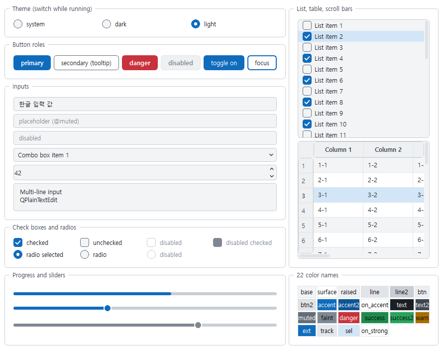
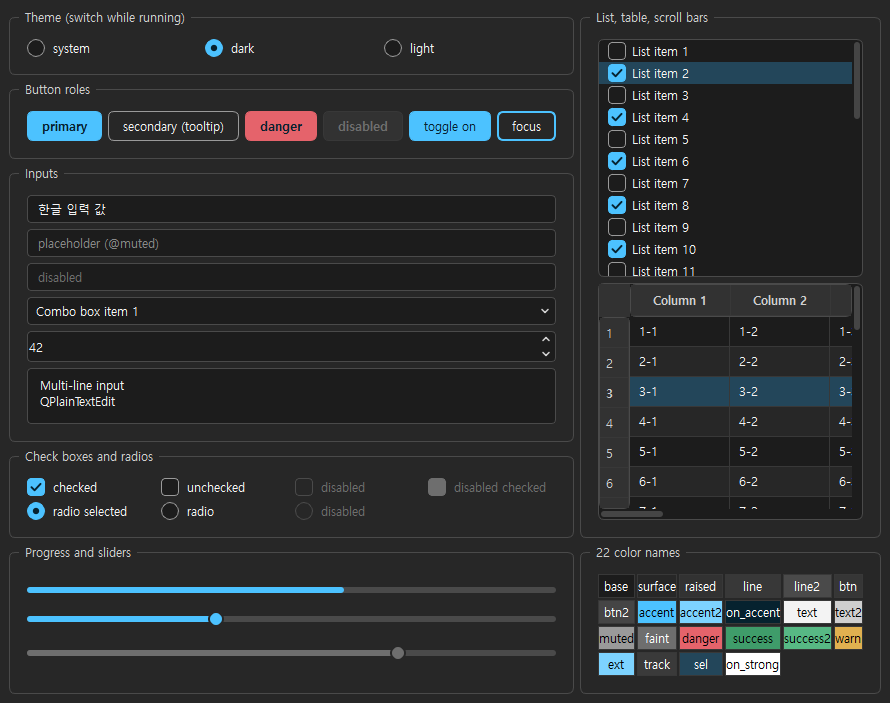

<p align="center">
  <strong>Language:</strong>
  <a href="README.md">English</a> |
  <a href="README.ko.md">한국어</a> |
  <a href="README.zh-CN.md">简体中文</a> |
  <a href="README.ja.md">日本語</a> |
  <a href="README.es.md">Español</a> |
  <a href="README.ru.md">Русский</a>
</p>

この文書は英語版を AI で翻訳したものです。内容が異なる場合は英語版に従ってください。

# Designarche

<p align="center">
  <a href="LICENSE"></a>
  <a href="https://agentskills.io/specification"></a>
  <a href="#状態"></a>
  <a href="#pyside6-テーマ"></a>
</p>

AI が作った画面が「生成された感じ」にならないようにする Agent Skill。Web、デスクトップ、モバイル、ターミナルで使えます。

## できること

Designarche は AI コーディングエージェント向けのスキルです。エージェントが画面を新しく作るときや既存の画面を直すとき、その画面が動くプラットフォームの慣習に従わせ、AI が作ったとすぐ分かるありがちなパターンを避けさせます。

- **新しい画面を作る。** プロジェクトから分からないことだけを一度だけ尋ね、具体的な言葉で短い方向性を書き（「すっきり、モダン」は不可）、そのプラットフォームのルールだけを読んでそのとおりに作ります。
- **既存の画面を監査する。** 見つけたものごとに場所と等級（`must-fix`、`should-fix`、`consider`）を付けて示し、止まって、ユーザーが選んだものだけを直します。
- **結果を検査する。** カラーモードごとのスクリーンショット、実測したコントラスト（WCAG 4.5:1 と 3:1）、プラットフォームのチェックリスト。`must-fix` が残っていなければ合格です。実行できなかった検査はそう報告し、合格扱いにはしません。
- **4 つのプラットフォームのルール：** Web、デスクトップ（Windows、macOS、Linux、ツールキットを問わず）、モバイル（iOS、Android、Flutter、React Native）、ターミナル（CLI、TUI）。
- **Python デスクトップアプリ用のテーマ：** PySide6 向けの Graphite（ダーク）と Paper（ライト）。

どの言語やフレームワークでも使えます。スキルは普通の Markdown と小さな Python スクリプトだけで、フックも、勝手に動くものもありません。

## インストール

スキルは `designarche` フォルダーです。エージェントがスキルを探す場所にコピー（またはリンク）してください。

```bash
git clone https://github.com/metapbl/Designarche.git
```

| エージェント | スキルフォルダー |
|---|---|
| Claude Code | `~/.claude/skills/designarche` |
| Codex | `~/.agents/skills/designarche` |
| Agent Skills を読むその他のエージェント | そのエージェントのスキルフォルダー |

macOS と Linux：

```bash
mkdir -p ~/.claude/skills && cp -R Designarche/designarche ~/.claude/skills/
```

Windows（PowerShell）：

```powershell
New-Item -ItemType Directory -Force "$HOME\.claude\skills" | Out-Null
Copy-Item -Recurse Designarche\designarche "$HOME\.claude\skills\designarche"
```

Codex では `~/.claude/skills` の代わりに `~/.agents/skills` を使います。その後エージェントのセッションを新しく始めると、スキル一覧に `designarche` が表示されます。

## 使い方

ふだんの言葉で頼めば、エージェントが依頼内容からスキルを使います。例：

- 「私の PySide6 写真整理ツールに設定ウィンドウを作って。」
- 「この Web アプリの旅行ページに AI っぽさがないか監査して。」
- 「この CLI の出力の色とヘルプ文の問題を検査して。」
- 「この PySide6 アプリに Graphite/Paper テーマを適用して。」

質問なしですぐ作ってほしいときは、最初にそう伝えてください（「そのままやって」）。エージェントは最初の行で何を仮定したかを書きます。

## 例:実際のアプリの監査

Claude Code でこのスキルを使い、PySide6 の動画ダウンローダー [AVD](https://github.com/metapbl/AVD) のメイン画面を監査しました。7 件の指摘を一覧にして止まり、作者が承認したあとで直しました。

| 等級 | 指摘 | 修正 |
|---|---|---|
| `must-fix` | ライトテーマの「完了」と警告の文字のコントラストが 3.23:1 と 4.29:1 | 文字は通常の文字色にし、緑と琥珀色は前の ✓ と ⚠ 記号だけに |
| `must-fix` | 空のリストの案内文字が 3.3:1 | より濃い補助文字色 (4.8:1 以上) |
| `must-fix` | 文字サイズが px 固定で、システムの文字サイズを無視する | pt 単位で、ディスプレイの拡大率には従う。**未解決:** Windows の文字サイズ 150% では文字が大きくならない。のちにルールを絞り、今は `should-fix` に当たる |
| `should-fix` | ボタン名の前の記号 (+ ⚙ ⓘ 📂 ▶) | 文字だけ |
| `should-fix` | ウィンドウの大きさと位置を覚えない | 保存して復元 |
| `consider` | 投稿者がないと情報行が「•」で始まる | 長さから始める |
| `consider` | リストを空にする・キャンセル・✕ の赤いホバー | 共通のホバースタイル |

修正後のチェックでダークとライトのスクリーンショットを撮り、コントラストを測り直して、測った範囲では `must-fix` は残りませんでした。システムの文字サイズ設定は試していないことも報告しており、あとで手で試すと文字サイズの指摘は解決していませんでした。このスキルが、実行しなかったチェックを合格と報告しないのはこのためです。

| 前 | 後 |
|---|---|
|  |  |

## PySide6 テーマ

Graphite（ダーク）と Paper（ライト）は、Windows と macOS の PySide6 デスクトップアプリと PyInstaller ビルド向けのテーマです。Python 3.10 以上と PySide6 6.8 以上が必要です。ジェネレーターはテーマファイル 1 つとアイコンフォルダーだけをアプリに入れ、このリポジトリのほかのものはアプリに入りません。

Graphite/Paper テーマのウィジェット一覧。左がライト、右がダークです。

| Paper（ライト） | Graphite（ダーク） |
|---|---|
|  |  |

```bash
python designarche/scripts/generate.py <app root> --theme ui/theme.py --icons assets/icons
```

テーマファイルのパスと、コピーしたアイコン数つきのアイコンフォルダーを出力します。どちらかが既にあればそのファイルを一覧にして止まります。上書きするには `--force` を付けてください。

```python
from PySide6.QtWidgets import QApplication
from ui import theme

app = QApplication([])
theme.apply_theme(app, "system")  # "system"、"dark" または "light"
```

色名、ボタンの役割、設定との接続、PyInstaller の手順は [designarche/references/pyside6-theme.md](designarche/references/pyside6-theme.md) にあります。

## 開発

```bash
python -m venv venv
venv/bin/python -m pip install -r requirements-dev.txt   # Windows: venv\Scripts\python
venv/bin/python -m pytest -q
venv/bin/python -m ruff check .
venv/bin/python gallery.py dark
```

テストはテーマ（コントラスト、アイコン、切り替え）、ジェネレーター、コントラストスクリプト、そしてスキルフォルダー自体（単独でコピーしても動き、Agent Skills の仕様に従うこと）を確認します。

## 状態

- Windows 11 と Claude Code で確認済みです。PySide6 アプリ 1 つと Web アプリ 1 つの監査も含みます。
- Codex も同じ Agent Skills 形式を読みますが、Codex へのインストールはまだ試していません。
- macOS と Linux は CI でテストを実行します。実機の Mac でテーマは確認していません。
- テーマのバージョンは 1.4.3 です。Web、Rust、Flutter のテーマジェネレーターをこの順で追加する予定です。

## ヘルプと貢献

質問やバグ報告はこのリポジトリの GitHub issues へどうぞ。ルールやスロップの兆候に問題があるときは、プラットフォーム、画面、期待した結果を書いてください。

ルールの修正、出典のある新しいスロップの兆候、翻訳はプルリクエストで受け付けます。1 つのプルリクエストには 1 つの変更だけを入れ、出す前に[開発](#開発)のテストとリントを実行してください。

## セキュリティ

スキルはフックをインストールせず、自分では何も実行しません。スクリプトはエージェントかあなたが呼んだときだけ動き、指定したプロジェクトフォルダーの中にだけ書き込みます（絶対パスと `..` は拒否し、`--force` なしでは既存ファイルを上書きしません）。ネットワークには接続しません。

脆弱性は公開 issue ではなく、このリポジトリの Security タブにある **Report a vulnerability** から報告してください。

## ライセンス

MIT。[LICENSE](LICENSE) を参照してください。ほかのスキルやガイドラインから得た考えの出典は [NOTICE](NOTICE) にあります。
