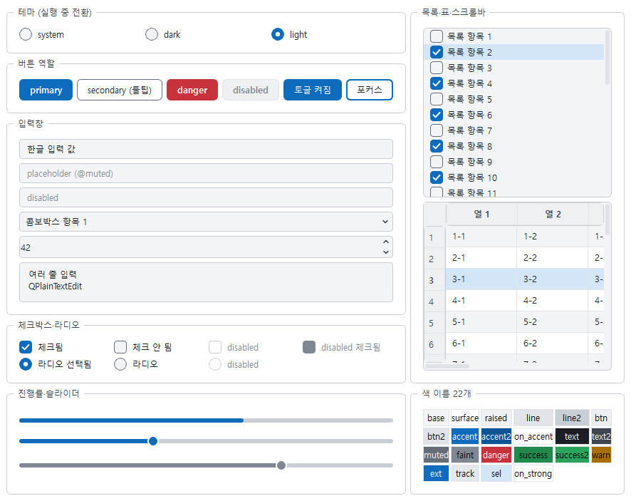
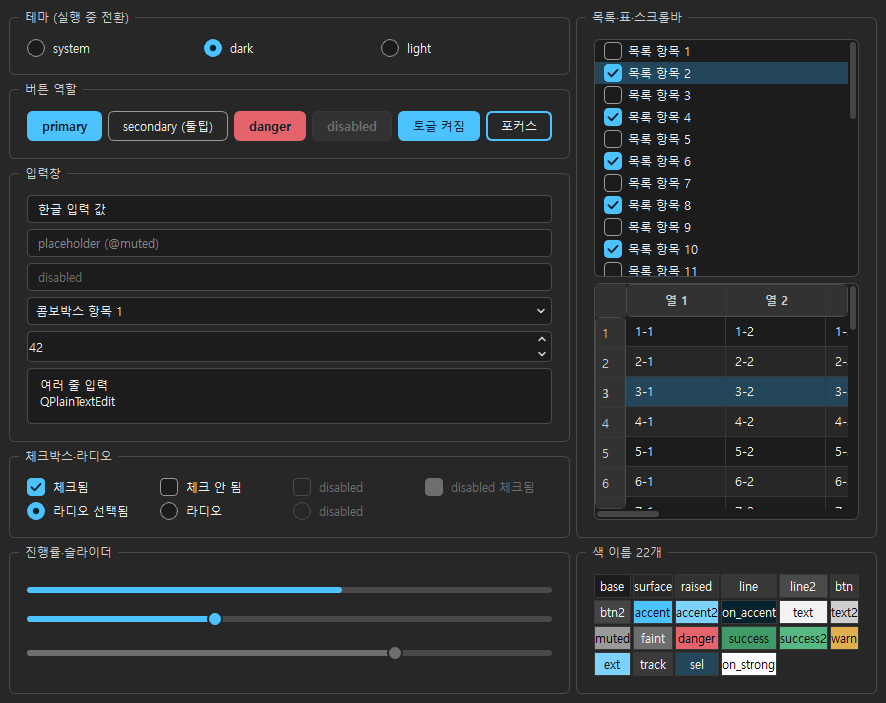

<p align="center">
  <strong>Language:</strong>
  <a href="README.md">English</a> |
  <a href="README.ko.md">한국어</a> |
  <a href="README.zh-CN.md">简体中文</a> |
  <a href="README.ja.md">日本語</a> |
  <a href="README.es.md">Español</a> |
  <a href="README.ru.md">Русский</a>
</p>

이 문서는 영어판을 AI로 번역한 것입니다. 내용이 다르면 영어판을 따릅니다.

# Designarche

<p align="center">
  <a href="LICENSE"></a>
  <a href="https://agentskills.io/specification"></a>
  <a href="#상태"></a>
  <a href="#pyside6-테마"></a>
</p>

AI가 만든 화면이 만들어 낸 티가 나지 않게 하는 Agent Skill. 웹, 데스크톱, 모바일, 터미널 모두에 씁니다.

## 하는 일

Designarche는 AI 코딩 에이전트용 스킬입니다. 에이전트가 화면을 새로 만들거나 기존 화면을 고칠 때, 그 화면이 도는 플랫폼의 관례를 따르게 하고 AI가 만든 화면임을 쉽게 드러내는 뻔한 패턴을 피하게 합니다.

- **새 화면 만들기.** 에이전트가 프로젝트에서 알 수 없는 것만 한 번 묻고, 짧은 방향 줄을 구체적인 말로 쓰고("깔끔하고 모던하게"는 안 됨), 해당 플랫폼 규칙만 읽고 그대로 만듭니다.
- **기존 화면 감사.** 찾은 것마다 위치와 등급(`must-fix`, `should-fix`, `consider`)을 붙여 보여 주고, 멈춘 뒤 사용자가 고른 것만 고칩니다.
- **결과 검사.** 색 모드마다 스크린샷, 대비 측정(WCAG 4.5:1과 3:1), 플랫폼 체크리스트. `must-fix`가 하나도 남지 않으면 통과이고, 돌리지 못한 검사는 그렇다고 보고하며 통과로 치지 않습니다.
- **네 플랫폼 규칙:** 웹, 데스크톱(Windows, macOS, Linux, 툴킷 무관), 모바일(iOS, Android, Flutter, React Native), 터미널(CLI, TUI).
- **Python 데스크톱 앱용 테마:** PySide6용 Graphite(다크)와 Paper(라이트).

어떤 언어나 프레임워크에서도 씁니다. 스킬은 평범한 Markdown과 작은 Python 스크립트뿐이고, 훅도 없고 혼자 실행되는 것도 없습니다.

## 스크린샷

Graphite/Paper 테마의 위젯 갤러리입니다. 왼쪽이 라이트, 오른쪽이 다크입니다.

| Paper (라이트) | Graphite (다크) |
|---|---|
|  |  |

## 설치

스킬은 `designarche` 폴더입니다. 에이전트가 스킬을 찾는 곳에 복사(또는 링크)하세요.

```bash
git clone https://github.com/metapbl/Designarche.git
```

| 에이전트 | 스킬 폴더 |
|---|---|
| Claude Code | `~/.claude/skills/designarche` |
| Codex | `~/.agents/skills/designarche` |
| Agent Skills를 읽는 그 밖의 에이전트 | 그 에이전트의 스킬 폴더 |

macOS와 Linux:

```bash
mkdir -p ~/.claude/skills && cp -R Designarche/designarche ~/.claude/skills/
```

Windows (PowerShell):

```powershell
New-Item -ItemType Directory -Force "$HOME\.claude\skills" | Out-Null
Copy-Item -Recurse Designarche\designarche "$HOME\.claude\skills\designarche"
```

Codex는 `~/.claude/skills` 대신 `~/.agents/skills`를 씁니다. 설치한 뒤 에이전트 세션을 새로 시작하면 스킬 목록에 `designarche`가 보입니다.

## 사용법

평소 말로 요청하면 에이전트가 요청을 보고 스킬을 씁니다. 예:

- "내 PySide6 사진 정리 도구에 설정 창 하나 만들어 줘."
- "이 웹앱의 여행 페이지에 AI 슬롭이 있는지 감사해 줘."
- "이 CLI 출력의 색과 도움말 문제를 검사해 줘."
- "이 PySide6 앱에 Graphite/Paper 테마를 적용해 줘."

질문 없이 바로 만들기를 원하면 처음에 그렇게 말하세요("그냥 해"). 에이전트가 첫 줄에 무엇을 가정했는지 밝힙니다.

## PySide6 테마

Graphite(다크)와 Paper(라이트)는 Windows와 macOS의 PySide6 데스크톱 앱과 PyInstaller 빌드용 테마입니다. Python 3.10 이상, PySide6 6.8 이상이 필요합니다. 생성기는 테마 파일 하나와 아이콘 폴더만 앱에 넣고, 이 저장소의 다른 것은 앱에 들어가지 않습니다.

```bash
python designarche/scripts/generate.py <app root> --theme ui/theme.py --icons assets/icons
```

테마 파일 경로와, 복사한 아이콘 수를 붙인 아이콘 폴더를 출력합니다. 둘 중 하나라도 이미 있으면 그 파일들을 보이고 멈춥니다. 덮어쓰려면 `--force`를 붙이세요.

```python
from PySide6.QtWidgets import QApplication
from ui import theme

app = QApplication([])
theme.apply_theme(app, "system")  # "system", "dark" 또는 "light"
```

색 이름, 버튼 역할, 설정 연결, PyInstaller 절차는 [designarche/references/pyside6-theme.md](designarche/references/pyside6-theme.md)에 있습니다.

## 개발

```bash
python -m venv venv
venv/bin/python -m pip install -r requirements-dev.txt   # Windows: venv\Scripts\python
venv/bin/python -m pytest -q
venv/bin/python -m ruff check .
venv/bin/python gallery.py dark
```

테스트는 테마(대비, 아이콘, 전환), 생성기, 대비 스크립트, 그리고 스킬 폴더 자체(폴더만 복사해도 동작하는지, Agent Skills 규격을 지키는지)를 확인합니다.

## 상태

- Windows 11과 Claude Code에서 확인했습니다. PySide6 앱 하나와 웹앱 하나의 감사도 포함합니다.
- Codex도 같은 Agent Skills 형식을 읽지만, Codex에 설치해 보지는 않았습니다.
- macOS와 Linux는 CI에서 테스트를 돌립니다. 실제 Mac에서 테마를 확인하지는 않았습니다.
- 테마 버전은 1.4.3입니다. 웹, Rust, Flutter 테마 생성기를 이 순서로 더할 계획입니다.

## 도움과 기여

질문과 버그 보고는 이 저장소의 GitHub 이슈에 남겨 주세요. 규칙이나 슬롭 징후에 문제가 있으면 플랫폼, 화면, 기대한 결과를 함께 적어 주세요.

규칙 수정, 출처가 있는 새 슬롭 징후, 번역은 풀 리퀘스트로 받습니다. 하나에 변경 하나만 담고, 열기 전에 [개발](#개발)의 테스트와 린트를 돌려 주세요.

## 보안

스킬은 훅을 설치하지 않고 스스로 아무것도 실행하지 않습니다. 스크립트는 에이전트나 사용자가 부를 때만 돌고, 지정한 프로젝트 폴더 안에만 씁니다(절대 경로와 `..`는 거부하고, `--force` 없이는 기존 파일을 덮어쓰지 않음). 네트워크에 접속하지 않습니다.

취약점은 공개 이슈 대신 이 저장소 Security 탭의 **Report a vulnerability**로 알려 주세요.

## 라이선스

MIT. [LICENSE](LICENSE)를 보세요. 다른 스킬과 지침에서 얻은 생각의 출처는 [NOTICE](NOTICE)에 있습니다.
