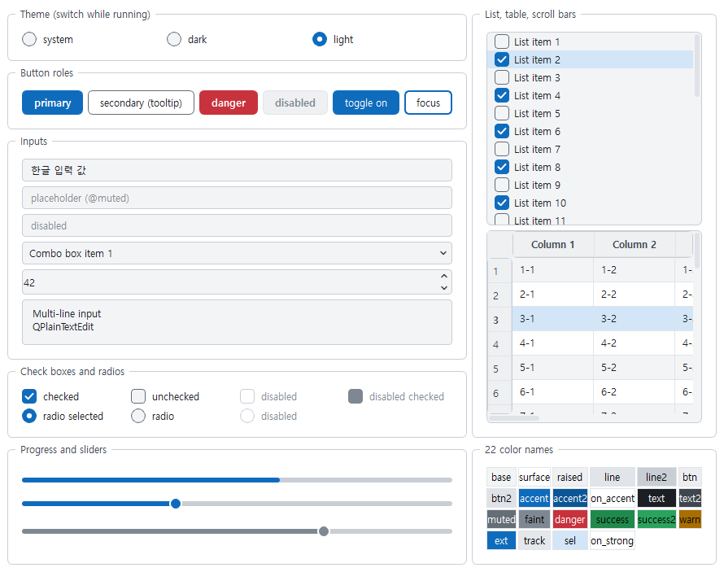
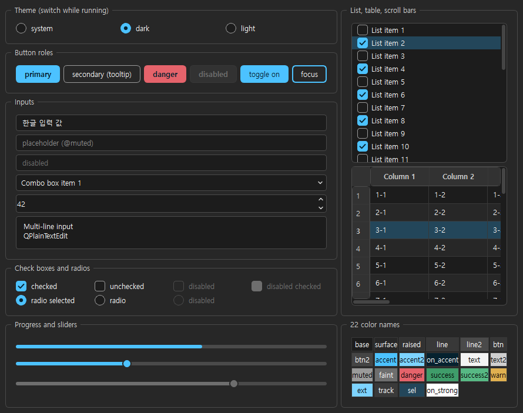

<p align="center">
  <strong>Language:</strong>
  <a href="README.md">English</a> |
  <a href="README.ko.md">한국어</a> |
  <a href="README.zh-CN.md">简体中文</a> |
  <a href="README.ja.md">日本語</a> |
  <a href="README.es.md">Español</a> |
  <a href="README.ru.md">Русский</a>
</p>

# Designarche

<p align="center">
  <a href="LICENSE"></a>
  <a href="https://agentskills.io/specification"></a>
  <a href="#status"></a>
  <a href="#the-pyside6-theme"></a>
</p>

An Agent Skill that keeps AI-built interfaces from looking generated, on web, desktop, mobile and terminal.

## What it does

Designarche is a skill for AI coding agents. When the agent builds a screen or touches an existing one, the skill makes it follow the platform the screen runs on and avoid the generic patterns that make AI-made interfaces easy to spot.

- **Build a new screen.** The agent asks you once what it cannot learn from the project, writes a short direction line in concrete words (no "clean, modern"), reads only the rules for your platform and builds to them.
- **Audit an existing screen.** The agent lists every finding with its location and a grade (`must-fix`, `should-fix`, `consider`), stops, and changes only what you approve.
- **Check the result.** Screenshots of each color mode, measured contrast (WCAG 4.5:1 and 3:1) and the platform's checklist. A screen passes when no `must-fix` is left; checks that could not run are reported, never assumed.
- **Rules for four platforms:** web, desktop (Windows, macOS, Linux; any toolkit), mobile (iOS, Android, Flutter, React Native) and terminal (CLI, TUI).
- **A ready theme for Python desktop apps:** Graphite (dark) and Paper (light) for PySide6.

It works in any language or framework. The skill is plain Markdown plus small Python scripts, with no hooks and nothing that runs on its own.

## Install

The skill is the `designarche` folder. Copy it (or link it) to where your agent looks for skills.

```bash
git clone https://github.com/metapbl/Designarche.git
```

| Agent | Skill folder |
|---|---|
| Claude Code | `~/.claude/skills/designarche` |
| Codex | `~/.agents/skills/designarche` |
| Other agents that read Agent Skills | the agent's skills folder |

macOS and Linux:

```bash
mkdir -p ~/.claude/skills && cp -R Designarche/designarche ~/.claude/skills/
```

Windows (PowerShell):

```powershell
New-Item -ItemType Directory -Force "$HOME\.claude\skills" | Out-Null
Copy-Item -Recurse Designarche\designarche "$HOME\.claude\skills\designarche"
```

For Codex, use `~/.agents/skills` instead of `~/.claude/skills`. Start a new agent session afterwards; the skill list should show `designarche`.

## Usage

Ask in your own words; the agent picks the skill up from the request. For example:

- "Build a settings window for my PySide6 photo organizer."
- "Audit the trips page of this web app for AI slop."
- "Check this CLI's output for color and help-text problems."
- "Apply the Graphite/Paper theme to this PySide6 app."

If you want the agent to skip its questions, say so up front ("just do it"); it will state what it assumed in its first line.

## Example: an audit of a real app

The skill audited the main window of [AVD](https://github.com/metapbl/AVD), a PySide6 video downloader, in Claude Code. It listed seven findings, stopped, and fixed them after the owner approved:

| Grade | Finding | Fix |
|---|---|---|
| `must-fix` | "Done" and warning text in the light theme at 3.23:1 and 4.29:1 | Text in the normal text color; green and amber only on the ✓ and ⚠ marks |
| `must-fix` | Empty-list hint at 3.3:1 | A darker secondary text color (4.8:1 or more) |
| `must-fix` | Font sizes fixed in px, which ignore the system text size | Sizes in pt, which follow display scaling. **Still open:** at 150% Windows text size the text does not grow. The rule was later narrowed, and this now counts as `should-fix` |
| `should-fix` | Symbols in front of button labels (+ ⚙ ⓘ 📂 ▶) | Plain labels |
| `should-fix` | Window size and position not remembered | Saved and restored |
| `consider` | Info line starting with "•" when the uploader is missing | The line starts with the duration |
| `consider` | Red hover on Clear list, Cancel and ✕ | The shared hover style |

After the fixes, the check took dark and light screenshots and measured contrast again; no `must-fix` was left in what it measured. It also reported that it had not tried the system text-size setting. Trying it by hand later showed the font-size finding was not solved, which is why the skill never reports a check it did not run as passed.

| Before | After |
|---|---|
|  |  |

## The PySide6 theme

Graphite (dark) and Paper (light) is a theme for PySide6 desktop apps and PyInstaller builds on Windows and macOS. It needs Python 3.10+ and PySide6 6.8+. The generator copies one theme file and an icon folder into your app; nothing else from this repository goes into the app.

The Graphite/Paper theme's widget gallery, light on the left and dark on the right.

| Paper (light) | Graphite (dark) |
|---|---|
|  |  |

```bash
python designarche/scripts/generate.py <app root> --theme ui/theme.py --icons assets/icons
```

It prints the theme file path and the icon folder with the number of icons copied. If either already exists, it lists the files and stops; add `--force` to overwrite them.

```python
from PySide6.QtWidgets import QApplication
from ui import theme

app = QApplication([])
theme.apply_theme(app, "system")  # "system", "dark" or "light"
```

Color names, button roles, settings and PyInstaller steps are in [designarche/references/pyside6-theme.md](designarche/references/pyside6-theme.md).

## Development

```bash
python -m venv venv
venv/bin/python -m pip install -r requirements-dev.txt   # Windows: venv\Scripts\python
venv/bin/python -m pytest -q
venv/bin/python -m ruff check .
venv/bin/python gallery.py dark
```

The tests cover the theme (contrast, icons, switching), the generator, the contrast script, and the skill folder itself (it must work when copied alone and follow the Agent Skills format).

## Status

- Checked on Windows 11 with Claude Code, including audits of a PySide6 app and a web app.
- Codex reads the same Agent Skills format; installing in Codex has not been tried yet.
- macOS and Linux run the test suite in CI; the theme has not been checked on a real Mac.
- The theme is version 1.4.3. Web, Rust and Flutter theme generators are planned, in that order.

## Help and contributing

Questions and bug reports go to the GitHub issues of this repository. When you report a problem with a rule or a slop sign, include the platform, the screen and what you expected.

Pull requests are welcome for rule fixes, new slop signs with a source, and translations. Keep each one to a single change, and run the tests and lint from [Development](#development) before you open it.

## Security

The skill installs no hooks and runs nothing by itself. Its scripts run only when the agent or you call them, write only inside the project folder you name (absolute paths and `..` are refused, existing files are kept unless you pass `--force`) and make no network connections.

To report a vulnerability, use **Report a vulnerability** on this repository's Security tab instead of a public issue.

## License

MIT. See [LICENSE](LICENSE). Ideas from other skills and guidelines are credited in [NOTICE](NOTICE).
