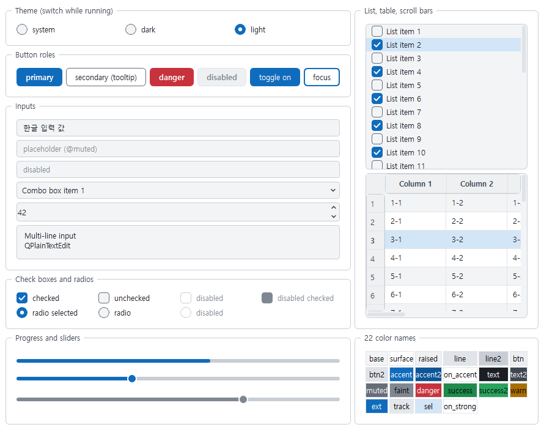
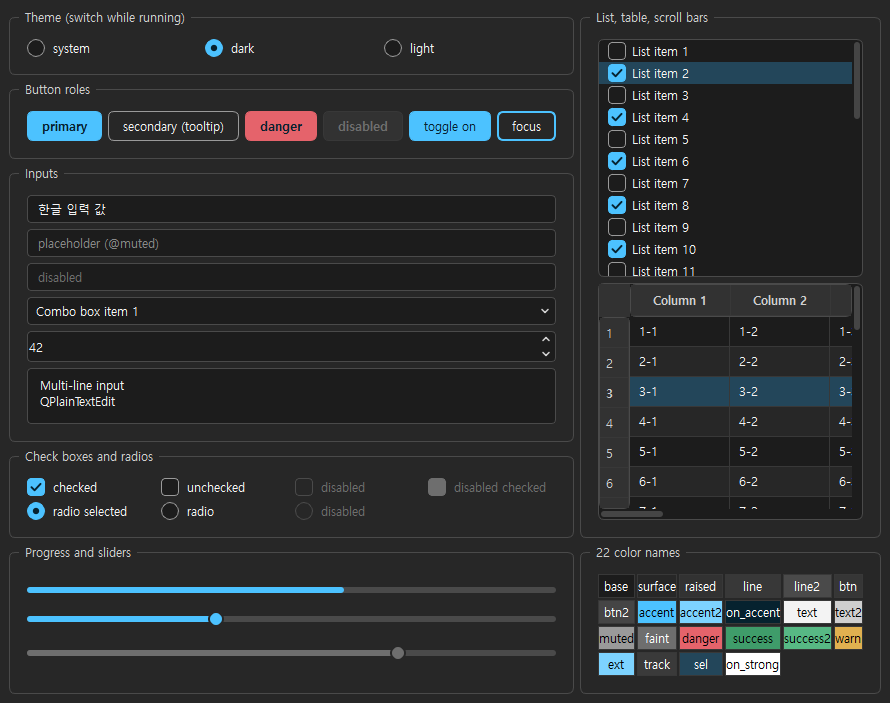

<p align="center">
  <strong>Language:</strong>
  <a href="README.md">English</a> |
  <a href="README.ko.md">한국어</a> |
  <a href="README.zh-CN.md">简体中文</a> |
  <a href="README.ja.md">日本語</a> |
  <a href="README.es.md">Español</a> |
  <a href="README.ru.md">Русский</a>
</p>

Этот документ переведён с английской версии с помощью ИИ. При расхождениях ориентируйтесь на английскую версию.

# Designarche

<p align="center">
  <a href="LICENSE"></a>
  <a href="https://agentskills.io/specification"></a>
  <a href="#состояние"></a>
  <a href="#тема-для-pyside6"></a>
</p>

Agent Skill, с которой интерфейсы, сделанные ИИ, не выглядят сгенерированными: в вебе, на десктопе, на мобильных и в терминале.

## Что она делает

Designarche — это навык для ИИ-агентов, которые пишут код. Когда агент создаёт экран или правит существующий, навык заставляет его следовать правилам платформы, на которой работает экран, и избегать шаблонных приёмов, по которым интерфейсы от ИИ узнаются с первого взгляда.

- **Создание нового экрана.** Агент один раз спрашивает то, чего нельзя узнать из проекта, пишет короткую строку направления конкретными словами (никаких «чисто, современно»), читает только правила вашей платформы и строит по ним.
- **Аудит существующего экрана.** Агент показывает каждую находку с местом и степенью (`must-fix`, `should-fix`, `consider`), останавливается и меняет только то, что вы одобрите.
- **Проверка результата.** Скриншоты каждой цветовой схемы, измеренный контраст (WCAG 4.5:1 и 3:1) и чек-лист платформы. Экран проходит, когда не остаётся ни одного `must-fix`; проверки, которые не удалось запустить, указываются явно и не засчитываются как пройденные.
- **Правила для четырёх платформ:** веб, десктоп (Windows, macOS, Linux; любой тулкит), мобильные (iOS, Android, Flutter, React Native) и терминал (CLI, TUI).
- **Готовая тема для настольных приложений на Python:** Graphite (тёмная) и Paper (светлая) для PySide6.

Работает с любым языком и фреймворком. Навык — это обычный Markdown и небольшие скрипты на Python, без хуков и без того, что запускается само.

## Установка

Навык — это папка `designarche`. Скопируйте её (или создайте ссылку) туда, где ваш агент ищет навыки.

```bash
git clone https://github.com/metapbl/Designarche.git
```

| Агент | Папка навыка |
|---|---|
| Claude Code | `~/.claude/skills/designarche` |
| Codex | `~/.agents/skills/designarche` |
| Другие агенты, читающие Agent Skills | папка навыков этого агента |

macOS и Linux:

```bash
mkdir -p ~/.claude/skills && cp -R Designarche/designarche ~/.claude/skills/
```

Windows (PowerShell):

```powershell
New-Item -ItemType Directory -Force "$HOME\.claude\skills" | Out-Null
Copy-Item -Recurse Designarche\designarche "$HOME\.claude\skills\designarche"
```

Для Codex используйте `~/.agents/skills` вместо `~/.claude/skills`. Затем начните новую сессию агента; в списке навыков должен появиться `designarche`.

## Использование

Просите своими словами — агент сам применит навык по запросу. Например:

- «Сделай окно настроек для моего органайзера фотографий на PySide6.»
- «Проверь страницу поездок этого веб-приложения на AI slop.»
- «Проверь вывод этой CLI на проблемы с цветом и текстом справки.»
- «Примени тему Graphite/Paper к этому приложению на PySide6.»

Если хотите, чтобы агент не задавал вопросов, скажите об этом сразу («просто сделай»); в первой строке он укажет, что предположил.

## Тема для PySide6

Graphite (тёмная) и Paper (светлая) — тема для настольных приложений на PySide6 и сборок PyInstaller в Windows и macOS. Нужны Python 3.10+ и PySide6 6.8+. Генератор копирует в приложение только один файл темы и папку иконок; больше ничего из этого репозитория в приложение не попадает.

Галерея виджетов темы Graphite/Paper: слева светлая, справа тёмная.

| Paper (светлая) | Graphite (тёмная) |
|---|---|
|  |  |

```bash
python designarche/scripts/generate.py <app root> --theme ui/theme.py --icons assets/icons
```

Он выводит путь к файлу темы и папку значков с числом скопированных значков. Если что-то из этого уже есть, он перечисляет эти файлы и останавливается; чтобы перезаписать их, добавьте `--force`.

```python
from PySide6.QtWidgets import QApplication
from ui import theme

app = QApplication([])
theme.apply_theme(app, "system")  # "system", "dark" или "light"
```

Названия цветов, роли кнопок, связь с настройками и шаги для PyInstaller описаны в [designarche/references/pyside6-theme.md](designarche/references/pyside6-theme.md).

## Разработка

```bash
python -m venv venv
venv/bin/python -m pip install -r requirements-dev.txt   # Windows: venv\Scripts\python
venv/bin/python -m pytest -q
venv/bin/python -m ruff check .
venv/bin/python gallery.py dark
```

Тесты проверяют тему (контраст, иконки, переключение), генератор, скрипт контраста и саму папку навыка (она должна работать, если скопировать только её, и соответствовать формату Agent Skills).

## Состояние

- Проверено в Windows 11 с Claude Code, включая аудит одного приложения на PySide6 и одного веб-приложения.
- Codex читает тот же формат Agent Skills; установку в Codex ещё не пробовали.
- macOS и Linux запускают тесты в CI; на настоящем Mac тему ещё не проверяли.
- Версия темы — 1.4.3. Генераторы тем для веба, Rust и Flutter запланированы в этом порядке.

## Помощь и участие

Вопросы и сообщения об ошибках оставляйте в GitHub issues этого репозитория. Если проблема в правиле или признаке слопа, укажите платформу, экран и ожидаемый результат.

Pull request'ы принимаются для исправлений правил, новых признаков слопа с источником и переводов. Ограничьте каждый одним изменением и перед открытием запустите тесты и линтер из раздела [Разработка](#разработка).

## Безопасность

Навык не устанавливает хуки и ничего не запускает сам. Его скрипты работают только когда их вызывает агент или вы, пишут только внутри указанной папки проекта (абсолютные пути и `..` отклоняются, существующие файлы сохраняются без `--force`) и не подключаются к сети.

Об уязвимостях сообщайте через **Report a vulnerability** на вкладке Security этого репозитория, а не в публичных issues.

## Лицензия

MIT. См. [LICENSE](LICENSE). Идеи из других навыков и руководств указаны в [NOTICE](NOTICE).
