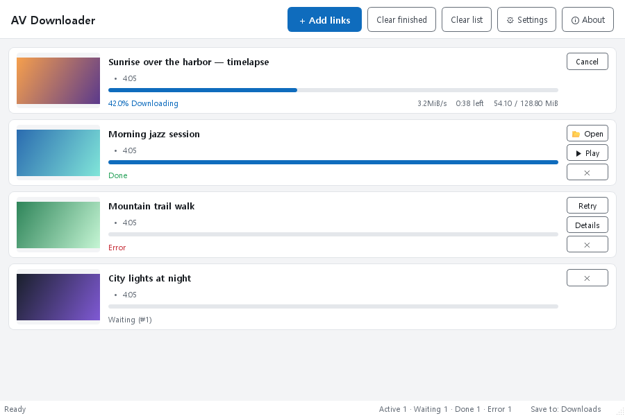
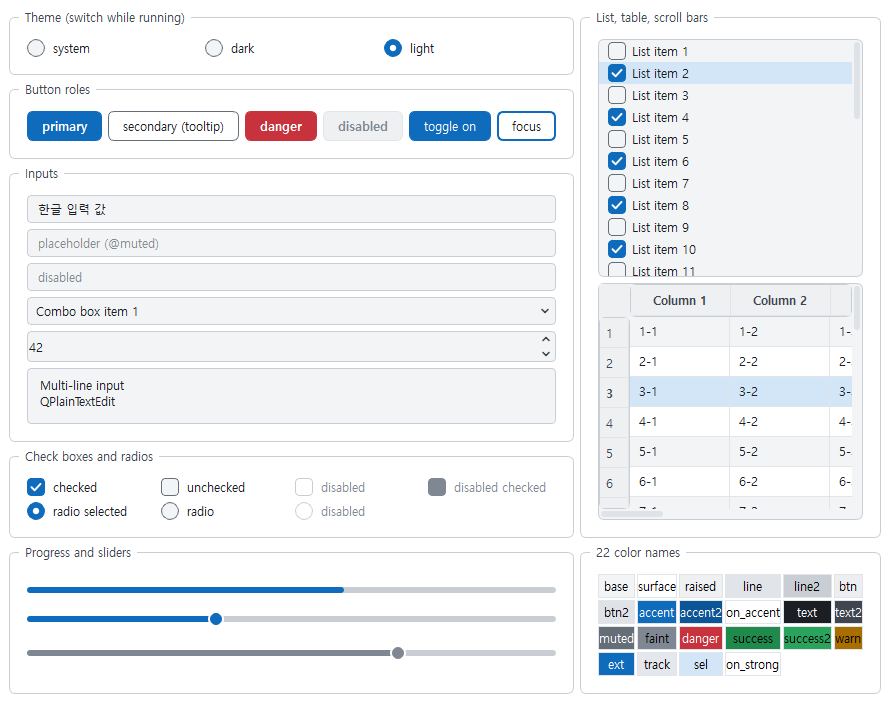
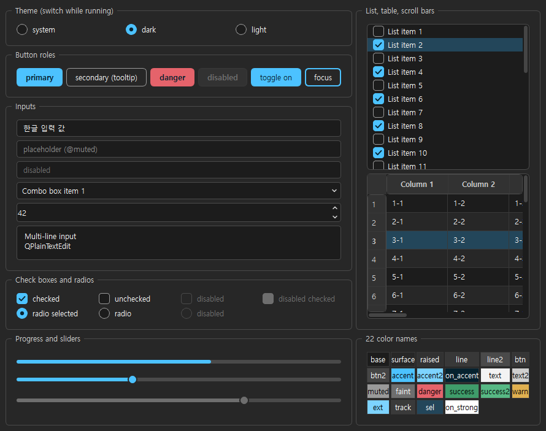

<p align="center">
  <strong>Language:</strong>
  <a href="README.md">English</a> |
  <a href="README.ko.md">한국어</a> |
  <a href="README.zh-CN.md">简体中文</a> |
  <a href="README.ja.md">日本語</a> |
  <a href="README.es.md">Español</a> |
  <a href="README.ru.md">Русский</a>
</p>

本文档由 AI 从英文版翻译而来。如有出入，以英文版为准。

# Designarche

<p align="center">
  <a href="LICENSE"></a>
  <a href="https://agentskills.io/specification"></a>
  <a href="#状态"></a>
  <a href="#pyside6-主题"></a>
</p>

一个 Agent Skill，让 AI 做出的界面不再一眼看出是生成的，适用于网页、桌面、移动端和终端。

## 功能

Designarche 是给 AI 编程助手用的技能。助手新建界面或修改已有界面时，它让界面遵循所在平台的惯例，避开那些让 AI 做的界面一眼就被认出的套路。

- **新建界面。** 助手只问一次项目里查不到的信息，用具体的词写一行设计方向（不能写"简洁、现代"），只读对应平台的规则，然后按规则实现。
- **审查已有界面。** 每个发现都带位置和等级（`must-fix`、`should-fix`、`consider`），列出后停下，只改你同意的项目。
- **检查结果。** 每种配色模式的截图、实测对比度（WCAG 4.5:1 和 3:1）以及平台检查清单。没有剩余 `must-fix` 才算通过；没能运行的检查会如实说明，不会当作通过。
- **四个平台的规则：** 网页、桌面（Windows、macOS、Linux，不限工具包）、移动端（iOS、Android、Flutter、React Native）和终端（CLI、TUI）。
- **Python 桌面应用的现成主题：** 用于 PySide6 的 Graphite（深色）和 Paper（浅色）。

适用于任何语言或框架。技能只有普通的 Markdown 和几个小 Python 脚本，没有钩子，也没有会自行运行的东西。

## 安装

技能就是 `designarche` 文件夹。把它复制（或链接）到助手查找技能的位置。

```bash
git clone https://github.com/metapbl/Designarche.git
```

| 助手 | 技能文件夹 |
|---|---|
| Claude Code | `~/.claude/skills/designarche` |
| Codex | `~/.agents/skills/designarche` |
| 其他读取 Agent Skills 的助手 | 该助手的技能文件夹 |

macOS 和 Linux：

```bash
mkdir -p ~/.claude/skills && cp -R Designarche/designarche ~/.claude/skills/
```

Windows（PowerShell）：

```powershell
New-Item -ItemType Directory -Force "$HOME\.claude\skills" | Out-Null
Copy-Item -Recurse Designarche\designarche "$HOME\.claude\skills\designarche"
```

Codex 请把 `~/.claude/skills` 换成 `~/.agents/skills`。之后新开一个助手会话，技能列表里应能看到 `designarche`。

## 用法

用自己的话提出请求，助手会根据请求使用这个技能。例如：

- "给我的 PySide6 照片整理工具做一个设置窗口。"
- "审查这个网页应用的行程页面有没有 AI 套路。"
- "检查这个命令行工具输出里的颜色和帮助文字问题。"
- "给这个 PySide6 应用套上 Graphite/Paper 主题。"

如果希望助手不提问直接做，一开始就说明（"直接做"）；它会在第一行说明自己做了哪些假设。

## 示例:审查一个真实应用

在 Claude Code 中用本技能审查了 PySide6 视频下载器 [AVD](https://github.com/metapbl/AVD) 的主窗口。它列出 7 条发现后停下,在所有者批准后才修改:

| 等级 | 发现 | 修改 |
|---|---|---|
| `must-fix` | 浅色主题中"完成"和警告文字的对比度为 3.23:1 和 4.29:1 | 文字用普通文字色,绿色和琥珀色只用于前面的 ✓ 和 ⚠ 标记 |
| `must-fix` | 空列表提示文字 3.3:1 | 更深的次要文字色(4.8:1 以上) |
| `must-fix` | 字号固定为 px,忽略系统文字大小 | 改用 pt,跟随显示缩放。**仍未解决:**Windows 文字大小设为 150% 时文字不变大。之后规则被收窄,现在属于 `should-fix` |
| `should-fix` | 按钮名称前的符号(+ ⚙ ⓘ 📂 ▶) | 只保留文字 |
| `should-fix` | 不记住窗口大小和位置 | 保存并恢复 |
| `consider` | 缺少上传者时信息行以"•"开头 | 以时长开头 |
| `consider` | 清空列表、取消和 ✕ 的红色悬停 | 共用的悬停样式 |

修改后,检查步骤重新截取深色和浅色截图并测量对比度,在测量范围内没有剩下 `must-fix`。它也报告了没有试过系统文字大小设置;之后手动试过才发现字号问题并未解决。这就是本技能从不把没运行的检查报告为通过的原因。

| 之前 | 之后 |
|---|---|
|  |  |

## PySide6 主题

Graphite（深色）和 Paper（浅色）是给 Windows 和 macOS 上的 PySide6 桌面应用及 PyInstaller 构建用的主题，需要 Python 3.10+ 和 PySide6 6.8+。生成器只会把一个主题文件和一个图标文件夹放进你的应用，本仓库的其他内容都不会进入应用。

Graphite/Paper 主题的控件展示，左边浅色，右边深色。

| Paper（浅色） | Graphite（深色） |
|---|---|
|  |  |

```bash
python designarche/scripts/generate.py <app root> --theme ui/theme.py --icons assets/icons
```

它会输出主题文件路径，以及图标文件夹和复制的图标数量。如果其中任一已存在，它会列出这些文件并停止；要覆盖请加 `--force`。

```python
from PySide6.QtWidgets import QApplication
from ui import theme

app = QApplication([])
theme.apply_theme(app, "system")  # "system"、"dark" 或 "light"
```

颜色名、按钮角色、设置连接和 PyInstaller 步骤见 [designarche/references/pyside6-theme.md](designarche/references/pyside6-theme.md)。

## 开发

```bash
python -m venv venv
venv/bin/python -m pip install -r requirements-dev.txt   # Windows: venv\Scripts\python
venv/bin/python -m pytest -q
venv/bin/python -m ruff check .
venv/bin/python gallery.py dark
```

测试覆盖主题（对比度、图标、切换）、生成器、对比度脚本，以及技能文件夹本身（单独复制也能用，并符合 Agent Skills 规范）。

## 状态

- 已在 Windows 11 和 Claude Code 上验证，包括对一个 PySide6 应用和一个网页应用的审查。
- Codex 读取同样的 Agent Skills 格式，但还没有实际在 Codex 中安装试过。
- macOS 和 Linux 在 CI 中运行测试；主题还没有在真机 Mac 上检查过。
- 主题版本为 1.4.3。计划依次加入网页、Rust、Flutter 的主题生成器。

## 帮助与贡献

问题和缺陷报告请提交到本仓库的 GitHub issues。如果是某条规则或某个套路特征有问题，请写明平台、界面和你期望的结果。

欢迎通过拉取请求提交规则修正、附带出处的新套路特征和翻译。每个请求只包含一项改动，提交前请运行[开发](#开发)中的测试和 lint。

## 安全

技能不安装任何钩子，也不会自行运行任何东西。脚本只在助手或你调用时运行，只写入你指定的项目文件夹（拒绝绝对路径和 `..`，不加 `--force` 不会覆盖已有文件），且不进行任何网络连接。

如需报告漏洞，请使用本仓库 Security 标签页中的 **Report a vulnerability**，不要提交公开 issue。

## 许可证

MIT。见 [LICENSE](LICENSE)。借鉴自其他技能和指南的思路，出处列在 [NOTICE](NOTICE) 中。
